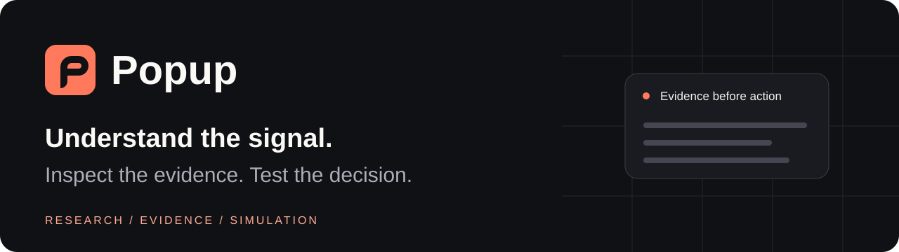
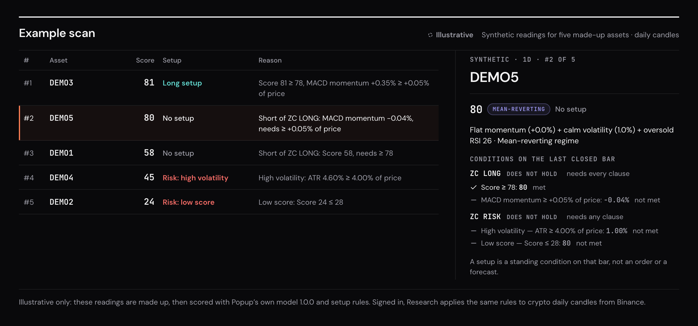
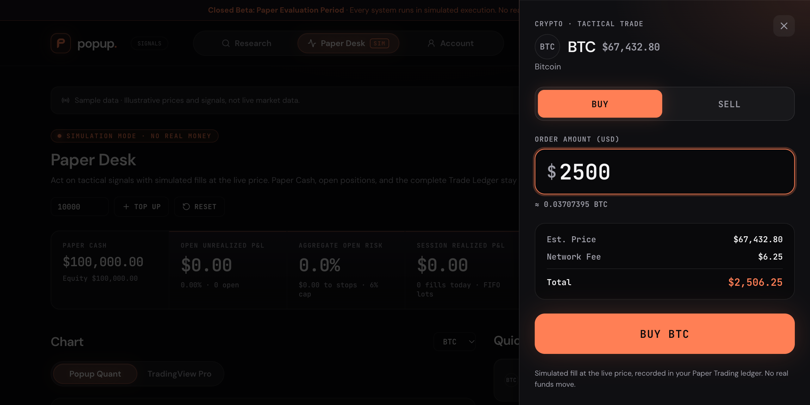

<div align="center">



# Popup

**Understand the signal. Inspect the evidence. Test the decision.**

A market research workspace for reviewing stocks, ETFs, and crypto, comparing scan snapshots,
and exploring decisions through backtesting and paper trading.

[](https://github.com/blackhebrewisraeli/Popup/actions/workflows/ci.yml)
[](docs/PRODUCT_STATUS.md)
[](https://www.typescriptlang.org/)
[](LICENSE)

[**Product overview**](https://blackhebrewisraeli.github.io/Popup/) · [**Hosted app**](https://popup-signals.vercel.app) · [Screenshots](#screenshots) · [Product status](docs/PRODUCT_STATUS.md) · [Getting started](#getting-started) · [Documentation](#documentation)

</div>

> [!NOTE]
> **Private testing / pre-beta.** Popup does not place real orders. Paper trades are simulated,
> and the owner-only Binance connection is read-only. Scores and backtests are research tools;
> investment performance has not been established.

## Why Popup

A ranked list alone does not explain a decision. Popup connects each result to its factors,
market regime, data coverage, and recorded source, then lets you compare what changed and test
hypothetical actions in a separate paper ledger.

| Research                                                                                                     | Paper Desk                                                                                             | Account                                                                                                |
| ------------------------------------------------------------------------------------------------------------ | ------------------------------------------------------------------------------------------------------ | ------------------------------------------------------------------------------------------------------ |
| Review bounded universes, compare compatible scans, and inspect the evidence behind scores and Risk warnings | Explore allocations, backtest, and book simulated trades with cash, positions, and transaction history | Keep manual holdings separate; inspect owner-only Binance Spot balances and bounded execution evidence |

### A typical workflow

1. **Review a scan.** Check its source, session, coverage, and missing-data states.
2. **Understand the result.** Inspect RSI, MACD, ATR, market regime, and the specific Risk clauses.
3. **Compare the evidence.** Use a compatible earlier snapshot to distinguish observed changes.
4. **Test a decision.** Explore a hypothetical scenario or paper trade; inspect the ledger afterward.

**Availability matters:** TradingView development scans are local and owner-initiated through an
authenticated agent. They are not an unattended scanner in the hosted app. Binance live market
data, TradingView alerts, and the read-only account connection are separate flows.

## Screenshots

Captured from the running application. Both show only the app's built-in synthetic or sample data
([how they were made](docs/PAGES.md#readme-screenshots)).



**Research: each result beside its evidence.** The app's built-in example scan, labeled
_Illustrative_: made-up readings for five made-up assets, scored by Popup's own model and setup
rules. The selected result shows why a score of 80 still meets no setup. No market data.



**Paper Desk: a simulated order.** A $2,500 paper buy previewed in the order ticket of a fresh
$100,000 paper account. Prices are the app's labeled _Sample data_, the order was not submitted,
and paper fills never reach a broker.

## Engineering highlights

- **Explainable model:** a canonical TypeScript scoring engine with factor contributions and explicit insufficient-data states; a Pine Script HUD with a documented comparison contract.
- **Reproducible research:** versioned candle contracts, captured scan inputs, and offline reproduction before reviewing saved scans.
- **Atomic accounting:** isolated Live Tracking, Simulation, and Paper Trading ledgers, FIFO lots, and fee-aware realized P&L.
- **Responsive compute:** indicator and backtest calculations run in a Web Worker; market updates subscribe by symbol.
- **Scoped access:** Supabase Auth and row-level security; authenticated TradingView ingestion; owner-only Binance reads.
- **Quality checks:** CI runs typecheck, build, lint, tests with coverage, and independent fixture reproduction.

[Technical feature guide](docs/WORKSPACE_GUIDE.md) · [Architecture and file map](ARCHITECTURE.md)

## Tech stack

| Layer              | Tools                                                                                             |
| ------------------ | ------------------------------------------------------------------------------------------------- |
| Application        | React 19, TypeScript, TanStack Start / Router / Query, Vite                                       |
| Interface          | Tailwind CSS v4, shadcn/ui, Radix, Framer Motion                                                  |
| Charts and compute | lightweight-charts, Recharts, Web Workers                                                         |
| Backend            | Supabase Postgres, Auth, row-level security, Realtime, Edge Functions                             |
| Integrations       | TradingView Pine Script v6 and webhooks; separate Binance market-data and read-only account paths |
| Verification       | Vitest, Testing Library, ESLint, Prettier, GitHub Actions                                         |

## Getting started

### Prerequisites

- [Node.js](https://nodejs.org/) 22+ (or [Bun](https://bun.sh/))
- A [Supabase](https://supabase.com/) project

### 1. Clone and install

```bash
git clone https://github.com/blackhebrewisraeli/Popup.git
cd Popup
npm ci --ignore-scripts
```

### 2. Configure environment variables

```bash
cp .env.example .env.local
```

Then fill in the two values from **Supabase → Project Settings → API**:

```env
VITE_SUPABASE_URL=https://<your-project-ref>.supabase.co
# Publishable key (sb_publishable_...); a legacy anon key also works
VITE_SUPABASE_PUBLISHABLE_KEY=sb_publishable_...
```

> [!WARNING]
> Only the publishable (anon) key belongs in the frontend. Never put a service-role or secret key in `.env.local`.

### 3. Set up the database

`supabase/migrations` is the only source of the schema. Link the Supabase CLI and push every migration:

```bash
npx supabase link --project-ref <your-project-ref>
npx supabase db push
```

Finally, make sure **Email** is enabled under **Authentication → Providers**.

### 4. Run the dev server

```bash
npm run dev
```

Open [http://localhost:8080](http://localhost:8080).

### 5. Optional: connect TradingView

1. Deploy the webhook (JWT verification is already turned off for it in [`supabase/config.toml`](./supabase/config.toml)):

   ```bash
   npx supabase functions deploy tv-webhook
   ```

2. In the app, open any asset and click **TradingView Indicator**, then click **Generate webhook token**. Copy the Pine Script after that: your token replaces `USER_SECRET_PLACEHOLDER` in its alert payloads.
3. Follow [TradingView notification meaning and secure setup](./docs/TRADINGVIEW_NOTIFICATIONS.md) to create separate machine and phone alerts. The machine alert uses **Machine JSON**, **Any alert() function call**, and the webhook only; the phone alert uses **Human readable** and has no webhook. Signals from other timeframes are recorded but can't be executed.

### Scripts

| Command              | Purpose                            |
| -------------------- | ---------------------------------- |
| `npm run dev`        | Start the dev server on port 8080  |
| `npm run build`      | Production build                   |
| `npm run preview`    | Serve the production build locally |
| `npm test`           | Run the Vitest suite once          |
| `npm run test:watch` | Run Vitest in watch mode           |
| `npm run lint`       | ESLint                             |
| `npm run format`     | Prettier                           |
| `npx tsc --noEmit`   | Typecheck                          |

## Quality gates

```bash
npm run typecheck
npm run build
npm run lint
npm test
```

[CI](.github/workflows/ci.yml) also collects coverage and reproduces the independent Python
reference fixtures. Production builds check the database contract before deployment; see
[release procedures](docs/RELEASE.md). Test results establish software behavior, not investment returns.

## Documentation

| Start here                                                                                                   | Purpose                                                                   |
| ------------------------------------------------------------------------------------------------------------ | ------------------------------------------------------------------------- |
| [Product status](docs/PRODUCT_STATUS.md)                                                                     | Current capabilities, private-testing boundaries, and next priorities     |
| [Technical feature guide](docs/WORKSPACE_GUIDE.md)                                                           | Model, ledgers, position sizing, webhook flow, and implementation details |
| [Architecture](ARCHITECTURE.md)                                                                              | Source map and feature ownership                                          |
| [Market scanner](docs/MARKET_SCANNER.md) / [crypto scan](docs/TRADINGVIEW_CRYPTO_SCAN.md)                    | Local scan workflow, source attribution, comparison, and coverage         |
| [Decision Journal](docs/DECISION_JOURNAL.md)                                                                 | Signal decisions and recorded evidence                                    |
| [Binance Spot account](docs/BINANCE_SPOT_ACCOUNT.md) / [reconciliation](docs/BINANCE_SPOT_RECONCILIATION.md) | Owner-only read access and finite-history limits                          |
| [Scanner research](docs/SCANNER_RESEARCH.md) / [model diagnostic](docs/MODEL_DIAGNOSTIC.md)                  | Findings, limitations, and the meaning of model conditions                |
| [Pine comparison contract](docs/PINE_PARITY_ASSESSMENT.md)                                                   | Supported comparison between app scores and Pine HUD                      |
| [TradingView setup](docs/TRADINGVIEW_NOTIFICATIONS.md)                                                       | Phone and webhook alerts, provenance, and secure setup                    |
| [Strategy validation](docs/STRATEGY_VALIDATION.md)                                                           | Private decision replay and observation contracts                         |
| [Releases](docs/RELEASE.md) / [contributing](CONTRIBUTING.md)                                                | Development checks, migrations, and review process                        |
| [Product page](docs/PAGES.md)                                                                                | Published overview, README screenshots, and Social Preview assets         |

## Contributing and feedback

Use [GitHub Issues](https://github.com/blackhebrewisraeli/Popup/issues) for reproducible bugs or
focused feature proposals. Read [CONTRIBUTING.md](CONTRIBUTING.md) before opening a pull request.
Keep account balances, credentials, and private research artifacts out of public reports.

Built and maintained by [Shimon Esterkin](https://github.com/blackhebrewisraeli).
Released under the [MIT License](LICENSE). Previously named **ZeroChart**; legacy identifiers
remain where compatibility or historical evidence requires them.
