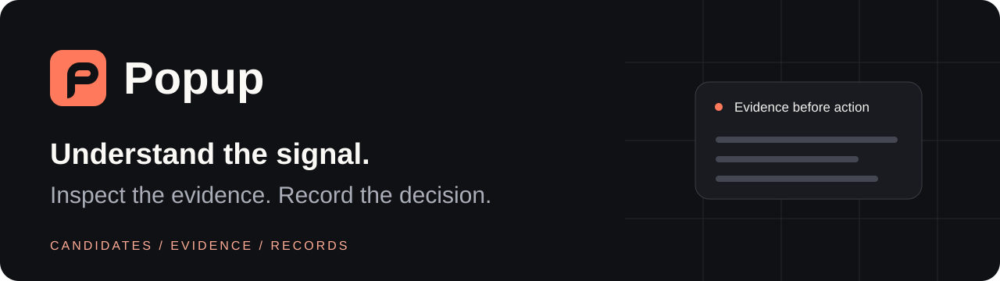

<div align="center">



# Popup

**Understand the signal. Inspect the evidence. Record the decision.**

A private Binance Spot workspace for reviewing daily candidates, checking intraday charts and
recording manual trading decisions.

[](https://github.com/blackhebrewisraeli/Popup/actions/workflows/ci.yml)
[](docs/PRODUCT_STATUS.md)
[](https://www.typescriptlang.org/)
[](LICENSE)

[**Open the app ↗**](https://popup-signals.vercel.app) (popup-signals.vercel.app) · [Product page](https://blackhebrewisraeli.github.io/Popup/) (overview only) · [Product status](docs/PRODUCT_STATUS.md) · [Getting started](#getting-started) · [Documentation](#documentation)

</div>

## Daily workflow

1. Open **Research → Daily candidates** and check the date and coverage. The shortlist is ranked
   by rolling 24-hour quote volume. Each pair links to its intraday chart on TradingView.
2. Open **Model scan (1D)** for context from closed daily candles. For a journal decision tied
   to a scan, open and reproduce a saved TradingView crypto snapshot in this tab.
3. Record a reason to stay out or a Manual Spot experiment from the snapshot. In **Journal**,
   review recorded decisions and linked Binance Spot fills and maintain your own exit rules and
   observations.

The daily shortlist is collected on a schedule. Creating a TradingView snapshot remains an
owner-initiated local workflow. The workspace is restricted to the configured owner, and the
Binance account connection is read-only. The model's scores and setups have no established
investment performance.

## Getting started

### Prerequisites

- [Node.js](https://nodejs.org/) 22+ (or [Bun](https://bun.sh/))
- A [Supabase](https://supabase.com/) project

### 1. Clone and install

```bash
git clone https://github.com/blackhebrewisraeli/Popup.git
cd Popup
npm ci --ignore-scripts
```

### 2. Configure environment variables

```bash
cp .env.example .env.local
```

Then fill in the two values from **Supabase → Project Settings → API**:

```env
VITE_SUPABASE_URL=https://<your-project-ref>.supabase.co
# Publishable key (sb_publishable_...); a legacy anon key also works
VITE_SUPABASE_PUBLISHABLE_KEY=sb_publishable_...
```

> [!WARNING]
> Only the publishable (anon) key belongs in the frontend. Never put a service-role or secret key in `.env.local`.

### 3. Set up the database

`supabase/migrations` is the only source of the schema. Link the Supabase CLI and push every migration:

```bash
npx supabase link --project-ref <your-project-ref>
npx supabase db push
```

Finally, make sure **Email** is enabled under **Authentication → Providers**.

### 4. Run the dev server

```bash
npm run dev
```

Open [http://localhost:8080](http://localhost:8080).

### Scripts

| Command              | Purpose                            |
| -------------------- | ---------------------------------- |
| `npm run dev`        | Start the dev server on port 8080  |
| `npm run build`      | Production build                   |
| `npm run preview`    | Serve the production build locally |
| `npm test`           | Run the Vitest suite once          |
| `npm run test:watch` | Run Vitest in watch mode           |
| `npm run lint`       | ESLint                             |
| `npm run format`     | Prettier                           |
| `npx tsc --noEmit`   | Typecheck                          |

## Quality gates

```bash
npm run typecheck
npm run build
npm run lint
npm test
```

[CI](.github/workflows/ci.yml) also collects coverage and reproduces the independent Python
reference fixtures. Production builds check the database contract before deployment; see
[release procedures](docs/RELEASE.md). Test results establish software behavior, not investment returns.

## Documentation

- [Product status](docs/PRODUCT_STATUS.md)
- [Architecture and file map](ARCHITECTURE.md)
- [Daily candidates and scan inputs](docs/MARKET_SCANNER.md)
- [Opening a saved crypto scan](docs/MARKET_SCANNER.md#opening-a-saved-crypto-scan-file)
- [Manual Spot journal](docs/MANUAL_SPOT_EXPERIMENTS.md)
- [Binance Spot account reads](docs/BINANCE_SPOT_ACCOUNT.md)
- [Historical scanner research](docs/SCANNER_RESEARCH.md)
- [Release procedures](docs/RELEASE.md)

## Contributing and feedback

Use [GitHub Issues](https://github.com/blackhebrewisraeli/Popup/issues) for reproducible bugs or
focused feature proposals. Read [CONTRIBUTING.md](CONTRIBUTING.md) before opening a pull request.
Keep account balances, credentials, and private research artifacts out of public reports.

Built and maintained by [Shimon Esterkin](https://github.com/blackhebrewisraeli).
Released under the [MIT License](LICENSE). Previously named **ZeroChart**; legacy identifiers
remain where compatibility or historical evidence requires them.
