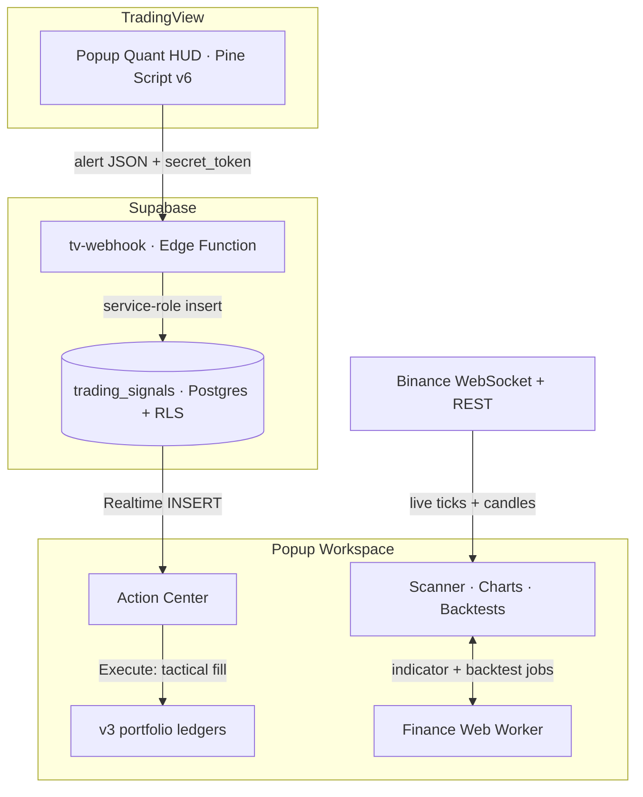

# Popup workspace technical guide

[← Product overview and setup](../README.md)

Implementation details for the research and paper-trading workspace. For current scanner and account boundaries, start with the [product status](PRODUCT_STATUS.md).

## The ecosystem

Popup is two products built on one quant model. The RSI / MACD / ATR model is implemented in TypeScript for the web app and ported to Pine Script. Like the app, the Pine script (model `1.0.0-pw200`) re-scores the latest 200 bars on every bar. On TradingView's `BINANCE:BTCUSDT` daily chart it matched every app decision at runtime, though not bit for bit, and other timeframes aren't comparable with the app's daily scores. [docs/PINE_PARITY_ASSESSMENT.md](../docs/PINE_PARITY_ASSESSMENT.md) states the comparison contract and measures the gap.

|                      | **Popup Quant HUD**                                                                                        | **Popup Workspace**                                                                                      |
| -------------------- | ---------------------------------------------------------------------------------------------------------- | -------------------------------------------------------------------------------------------------------- |
| **Runs on**          | TradingView, as a Pine Script v6 overlay                                                                   | The browser: React 19 on TanStack Start, backed by Supabase                                              |
| **Job**              | Live visual signals on any chart                                                                           | Portfolio accounting, strategy backtesting, paper-trade execution                                        |
| **Shows**            | On-chart HUD table: quant score, market regime, factor breakdown, position size, ATR stop, one-line thesis | Research (scanner, charts, signals), Paper Desk (paper trading, simulated portfolio, backtests), Account |
| **Emits / consumes** | Emits alerts: high-conviction bullish, regime shift to high volatility, ATR trailing-stop breach           | Consumes those alerts through a secured webhook, in real time                                            |
| **Source**           | [`pine/zerochart_quant_hud.pine`](../pine/zerochart_quant_hud.pine)                                        | [`src/`](../src) and [`supabase/`](../supabase)                                                          |

## Flagship features

### Web Worker multi-factor engine

- Scores every asset 0–100 by blending three normalized factors: **RSI** mean reversion (40%), **MACD** momentum (40%), and **ATR** volatility regime (20%).
- Detects the market regime (high volatility, trending, mean-reverting, or neutral) and tilts the weights toward the factor that regime rewards.
- One canonical engine, [`canonicalModel.ts`](../src/lib/canonicalModel.ts), scores every surface (Scanner, Portfolio, Quant Analyzer, Tactical Signals, shared snapshots) from the latest 200 closed daily candles. The Pine HUD shares its factor math, within the bounds in [docs/PINE_PARITY_ASSESSMENT.md](../docs/PINE_PARITY_ASSESSMENT.md). An asset with fewer than 34 daily candles reports `INSUFFICIENT_DATA` and shows "Not Enough Data", never a guessed score.
- Every score is explainable: sub-scores, applied weights, regime, and a one-line rationale.
- Heavy math (SMA, RSI, MACD, ATR, full backtests) runs off the main thread in [`finance.worker.ts`](../src/lib/finance.worker.ts), with results cached and served through the async [`financeClient.ts`](../src/lib/financeClient.ts) API, so charts never freeze the UI.

### v3 atomic accounting

- Three strictly isolated ledgers per user: **Live Tracking**, **Simulation**, and **Paper Trading**, each with its own positions, cash, cash ledger, transactions, and realized P&L. Paper Trading and Simulation live on the Paper Desk; Live Tracking (real holdings, logged by hand) appears only under Account, so real and simulated money never share a screen.
- Every buy, sell, deposit, and withdrawal is a pure, immutable state transition in [`portfolioAccounting.ts`](../src/lib/portfolioAccounting.ts). Positions, cash, and the transaction log move together, or the trade is rejected and nothing changes.
- Multi-lot cost basis, FIFO lot consumption on sells, and fee- and slippage-aware realized P&L. Valuation reports missing prices honestly instead of guessing.
- Older v1 and v2 payloads migrate deterministically into the v3 snapshot on load.

### Dynamic position sizing

- ATR-based sizing in [`risk.ts`](../src/lib/risk.ts): the position is sized `q = min(risk budget / stop distance, capital / price)`, so a stop two ATRs away loses at most your chosen risk (2% of capital by default).
- Hard invariants: notional never exceeds the capital or per-asset budget, the stop price is floored at zero, and shares round to four decimals (down, when needed, to stay within budget). When the budget binds, the position and its risk come in below the target.
- The Quant Analyzer and the asset detail view call `risk.ts` directly. The Pine HUD applies the same budget-capped sizing and the same 2× ATR stop by default; its stop multiplier is configurable.
- The server enforces the same limits. Every Paper Trading BUY must keep Aggregate Open Risk within 6% of total equity ([`check_paper_transaction`](../supabase/migrations/20261022130000_paper_portfolio_execution.sql)). The Quant Analyzer books a whole proposal through `execute_paper_portfolio`: one transaction from existing Paper Cash, priced at the server quote, sized under each holding's ATR risk cap, and idempotent on its request ID. Confirm books the previewed orders or nothing: if any price or size moved more than 0.5% (the paper fill tolerance) since the preview, it shows the repriced plan for a fresh Confirm. A booking whose answer was lost is settled by its request ID, even after the dialog closes or the page reloads. Planned stops are sizing assumptions; Paper Trading places no stop orders.

### Real-time webhook Action Center

- TradingView alerts post to the [`tv-webhook`](../supabase/functions/tv-webhook/index.ts) Edge Function. Each user authenticates with a rotating `secret_token` that is stored only as a SHA-256 hash.
- TradingView cancels a delivery after 3 seconds, so one database call (`ingest_tradingview_signal`) authenticates the token and records the signal, and the function answers only once the row has committed. Validation errors are reported only to an authenticated caller. Payloads carry ticker, BUY/SELL action, 0–100 `signal_score`, `price`, `quantity` in units, an optional stop, and, from the current HUD, exchange, timeframe, bar time and model version. They land in `trading_signals` as `PENDING`. A unique `(user, ticker, action, event_id)` index turns a re-delivered alert into a `200 duplicate`. Each delivery logs one JSON line naming its outcome.
- The [Action Center](../src/components/ActionCenter.tsx) streams new signals over Supabase Realtime. **Execute** books a tactical fill into the Paper Trading ledger at the live price, and only then marks the signal `EXECUTED`; **Dismiss** retires the signal through `dismiss_tactical_signal`, which records when, by whom and, optionally, why ([docs/DECISION_JOURNAL.md](../docs/DECISION_JOURNAL.md#dismissal-evidence)).
- Row-level security lets users read only their own signals and move them out of `PENDING` once. Ticker, size, and stop are writable only by the webhook, so the audit trail can't be rewritten.

### Also included

| Feature                  | What it does                                                                                                                     |
| ------------------------ | -------------------------------------------------------------------------------------------------------------------------------- |
| **Live market stream**   | Binance all-market ticker over WebSocket, batched into a `useSyncExternalStore` store so only rows whose price changed re-render |
| **Canvas charts**        | `lightweight-charts` candlesticks with SMA 50/200 and a synchronized RSI pane                                                    |
| **Backtesting**          | Replays an allocation over a year of daily candles, with max drawdown and Sharpe ratio                                           |
| **Quant Analyzer**       | Builds a signal-ranked, risk-weighted portfolio from your Paper Cash and risk profile, then books it in one server transaction   |
| **Price alerts**         | Cloud-synced (RLS) for signed-in users, session-only for guests; each alert fires exactly once                                   |
| **Shareable portfolios** | Read-only snapshot links at `/p/:portfolioId` that anyone can open                                                               |

## Tech stack

| Layer           | Technology                                                                                                                                            |
| --------------- | ----------------------------------------------------------------------------------------------------------------------------------------------------- |
| **Frontend**    | [React 19](https://react.dev/), [TanStack Start](https://tanstack.com/start) (SSR + file-based routing), [TanStack Query](https://tanstack.com/query) |
| **Build**       | [Vite](https://vite.dev/), [TypeScript](https://www.typescriptlang.org/) (strict)                                                                     |
| **Styling**     | [Tailwind CSS v4](https://tailwindcss.com/), [shadcn/ui](https://ui.shadcn.com/) on Radix primitives, [Framer Motion](https://motion.dev/)            |
| **Charts**      | [lightweight-charts](https://www.tradingview.com/lightweight-charts/) (Canvas), [Recharts](https://recharts.org/)                                     |
| **Compute**     | Web Workers for indicator and backtest math                                                                                                           |
| **Backend**     | [Supabase](https://supabase.com/): Postgres + RLS, Auth, Realtime, Edge Functions (Deno)                                                              |
| **Market data** | Binance WebSocket and REST APIs                                                                                                                       |
| **Indicator**   | [Pine Script v6](https://www.tradingview.com/pine-script-docs/) on TradingView                                                                        |
| **Quality**     | [Vitest](https://vitest.dev/), Testing Library, ESLint, Prettier, GitHub Actions                                                                      |
